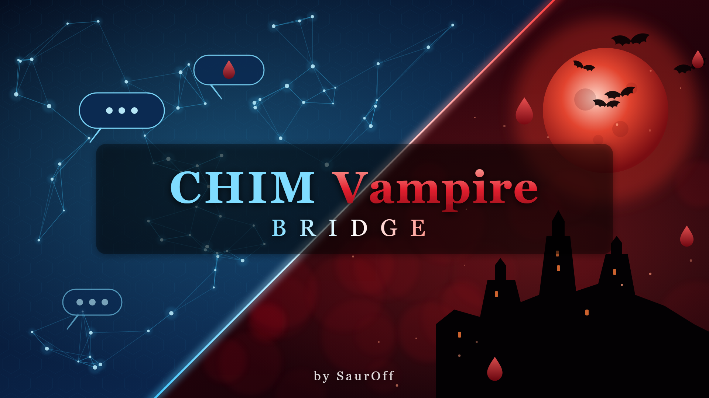

# CHIM Vampire Bridge

A Skyrim SE/AE mod by **SaurOff** that gives [CHIM](https://www.nexusmods.com/skyrimspecialedition/mods/126330)
(AI-driven NPCs) vampires: they drink blood and can pass on vampirism with the bite,
Vampire Lords turn the player into a Vampire Lord the way Dawnguard does, and the
Vampire Lords and the Volkihar court bind thralls who obey them and the player in
everything - enemies too, taken alive.

Until its version 1.2 these features were part of my **CHIM OStim Bridge**
([Nexus](https://www.nexusmods.com/skyrimspecialedition/mods/194761) ·
[GitHub](https://github.com/SimpleL97/CHIM-OStim-Bridge)); now each has its own mod.
Both, and **CHIM ORomance Bridge** ([GitHub](https://github.com/SimpleL97/CHIM-ORomance-Bridge)),
work on their own and see each other when installed together: with CHIM OStim Bridge a
thrall can be undressed and brought into OStim scenes by name.

> **Adult content.** Together with CHIM OStim Bridge this mod deals with sexual content
> in a video game and is meant for adults only.

This repository is the complete source of the mod. Players should download the packaged
release (FOMOD archive) instead of building it.

- **[BUILDING.md](BUILDING.md)** - how to build the release from these sources
- **[DEPENDENCIES.md](DEPENDENCIES.md)** - every requirement and what it is used for
- [docs/README.txt](docs/README.txt) - the player readme shipped in the archive
- [docs/CHANGELOG.txt](docs/CHANGELOG.txt)

## What it does

- **AI actions** added to CHIM's action list: `Feed_On_Blood`, `Turn_Into_Vampire_Lord`
  (Dawnguard's own steps: the bite, the vampire change, the Vampire Lord power and perk
  tree), `Enthrall` / `Release_Thrall`, `Spare` (companions take enemies alive - one by
  name, or women / men / everyone as a standing order; the nearest Vampire Lord hears
  when one is beaten down and can bind them). Every result is reported back to the AI,
  so a refusal is answered in character.
- **Blood thirst** for real game vampires, NPCs turned by a bite and the names in the MCM.
- **Vampirism by bite**: the game's Sanguinare Vampiris; an NPC not cured in time is a
  vampire from then on.
- **Thralls**: Vampire Lords (Dawnguard's own and the names in the MCM), the Volkihar
  court and the names in the MCM bind thralls; the player gets the lesser power
  "Vampire's Thrall" (shout key) once they are a Vampire Lord: it raises the dead as
  thralls (not the living), and sleeping people get "Make your thrall" next to Feed
  (E). Both are MCM switches. Thralls of living blood are fed on like Castle
  Volkihar's (E, standing: Talk or Feed), and thirsty Vampire Lord companions drink
  from them; no feeding on undead, spirits or summoned beings. Thralls obey, released
  thralls remember. Vampire Lords (the player too) raise the dead as thralls, alive and
  whole; "turn the women into thralls" has them bind every spared enemy who is down.
- **Notifications and a log file** in the game and on the CHIM server.
- **MCM** through MCM Helper, translated into 12 languages with English fallback.

## How it works

```
          Skyrim (game)                                    CHIM server (WSL, HerikaServer)
 +-------------------------------+                 +------------------------------------------+
 | CHIMVampireBridge.esp (ESL)   |                 | ext/cov_vampire_bridge/                  |
 |  COV_Bridge  <----------------+-- ExtCmdCOV_*   |  functions.php   actions for the LLM,     |
 |   bite, gift, thralls (via    |   (via COV)     |                  installed into           |
 |   COV_Thralls), reports ------+---------------->|                  core_action_custom       |
 |  COV_Events                   |   funcret       |  prompts.php     cues for the events      |
 |   vampires near the player,   |                 |  preprocessing   silent state             |
 |   infections, thralls, MCM ---+---------------->|  context_pre     blood thirst, the gift,  |
 |  COV_MCM (MCM Helper)         |  cov_* events   |                  thralls -> every prompt  |
 |  COV_ThrallPower (lesser pow.)|                 |  cov_lib.php     shared code, state in    |
 +-------------------------------+                 |                  conf_opts                |
   Data/CHIM/server-plugins/                       +------------------------------------------+
   cov_vampire_bridge/<ver>.dwpkg ---- installed by CHIM at game start
```

1. The LLM picks one of the actions while replying. CHIM's game plugin hands it to the
   global function `COV.DispatchExternalCommand`, which forwards it to `COV_Bridge` as the
   mod event `COV_Command`.
2. `COV_Bridge` does it and reports the outcome back to CHIM (`funcret`, through
   `AIAgentFunctions.logMessageForActor`).
3. `COV_Events` tells the server who is a vampire, a Vampire Lord or a Volkihar noble near
   the player, who fed, and the thralls (silent `cov_state` lines), and turns NPCs whose
   infection was not cured in time.
4. The server plugin turns that state into a few lines at the end of each agent's prompt.

The other bridges are optional on both sides: in the game, CHIM OStim Bridge reads the
StorageUtil list `COV_Thralls`; on the server each plugin only reads another one's settings
when that plugin is installed and switched on.

## Repository layout

```
src/Scripts/Source/   Papyrus sources: COV (CHIM entry point), COV_Bridge, COV_Thralls,
                      COV_Events, COV_MCM, COV_Config, COV_EnthrallEffect (lesser power)
server/
  cov_vampire_bridge/  CHIM server plugin (PHP) - packaged into the .dwpkg
  *.bat, *.ps1          optional manual install / uninstall of the server plugin
mcm/                  MCM Helper menu (config.json, settings.ini) and translations/
fomod/                FOMOD installer (info.xml, ModuleConfig.xml, images/)
docs/                 player README, CHANGELOG
art/                  banner generator and the banner (README, FOMOD installer)
stubs/                declaration-only Papyrus files for the compiler (not shipped)
tools/                build without the game (build_linux.sh) and its headers (gen_headers.py)
make_esp.py           writes the plugin CHIMVampireBridge.esp
compile_scripts.ps1   compiles the Papyrus scripts with Bethesda's compiler
localize.py           MCM menu, string table and translation file generator
build.py              builds the .dwpkg and the FOMOD release zip
verify_release.py     checks the release zip against the sources
```

## Building

Every GitHub release is built by `.github/workflows/release.yml` with the open-source
papyrus-compiler; locally (details in [BUILDING.md](BUILDING.md)):

```
tools/build_linux.sh <papyrus-compiler binary>
```

## Installing (players)

Requirements: SKSE64, Address Library, Dawnguard, CHIM (plugin and server), PapyrusUtil,
SkyUI, MCM Helper - see [DEPENDENCIES.md](DEPENDENCIES.md).

Optional: **CHIM OStim Bridge** ([Nexus](https://www.nexusmods.com/skyrimspecialedition/mods/194761) ·
[GitHub](https://github.com/SimpleL97/CHIM-OStim-Bridge)) - thralls in OStim scenes;
**CHIM ORomance Bridge** ([GitHub](https://github.com/SimpleL97/CHIM-ORomance-Bridge)).

Install the release archive with Vortex or MO2, start the CHIM server, then the game.
More in [docs/README.txt](docs/README.txt).

## License

The mod's own code and files are released under the [MIT License](LICENSE).
The files in `stubs/` only declare the public script APIs of their owners for the
compiler; they are not covered by this license and are not shipped. CHIM, Dawnguard and
the other requirements belong to their authors and are not included here.

## Credits

Dwemer Dynamics for CHIM, Bethesda for Dawnguard, exiledviper and meh321 for PapyrusUtil,
the SkyUI team, Exit-9B for MCM Helper, the SKSE team.
