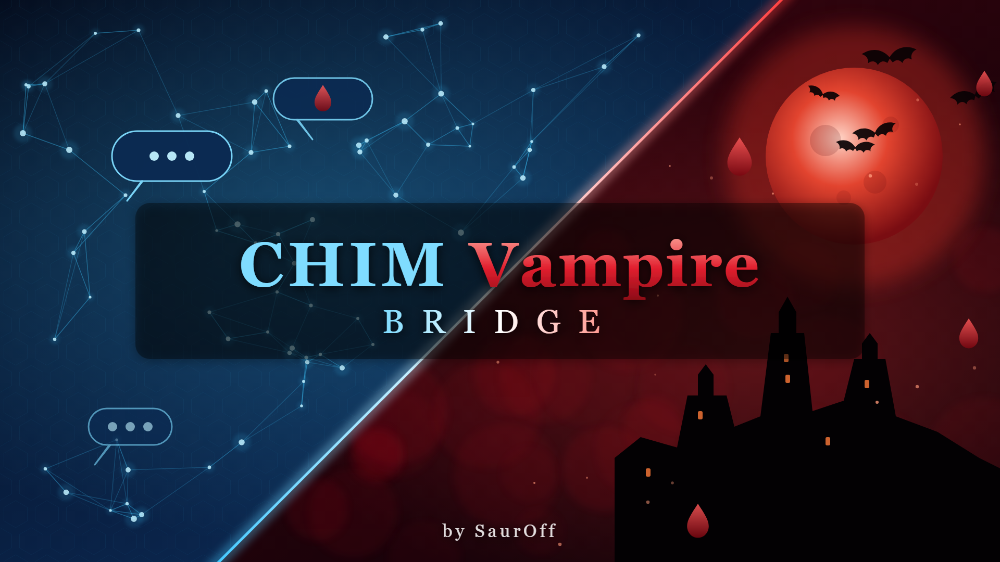

# CHIM Vampire Bridge

A Skyrim SE/AE mod by **SaurOff** that gives [CHIM](https://www.nexusmods.com/skyrimspecialedition/mods/126330)
(AI-driven NPCs) vampires: they drink blood and can pass on vampirism with the bite,
Vampire Lords turn the player into a Vampire Lord the way Dawnguard does, and the
Vampire Lords and the Volkihar court bind thralls who obey them and the player in
everything - enemies too, taken alive.

**Where it comes from.** These features were part of my **CHIM OStim Bridge**
([Nexus](https://www.nexusmods.com/skyrimspecialedition/mods/194761) ·
[GitHub](https://github.com/SimpleL97/CHIM-OStim-Bridge)):
- blood thirst, the bite, Sanguinare Vampiris and Vampire Lords came out in its 1.1.0;
- the thralls were being made for its 1.2.

In CHIM OStim Bridge 2.0 all of them are **removed** and live here, much extended; that mod
has no vampire actions or settings any more. Coming from CHIM OStim Bridge 1.x, install this
mod and update that one to 2.0. This mod moves over the bitten, turned and thrall NPCs of
your save, the vampire state on the CHIM server, and the actions (same names) by itself.

> **Nexus page: [CHIM Vampire Bridge](https://www.nexusmods.com/skyrimspecialedition/mods/198441)** - download the packaged release there.

> **Adult content.** Together with CHIM OStim Bridge this mod deals with sexual content
> in a video game and is meant for adults only.

This repository is the complete source of the mod. Players should download the packaged
release (FOMOD archive) from the [Nexus page](https://www.nexusmods.com/skyrimspecialedition/mods/198441) instead of building it.

- **[BUILDING.md](BUILDING.md)** - how to build the release from these sources
- **[DEPENDENCIES.md](DEPENDENCIES.md)** - every requirement and what it is used for
- [docs/README.txt](docs/README.txt) - the player readme shipped in the archive
- [docs/CHANGELOG.txt](docs/CHANGELOG.txt)

## What it does

**AI actions** added to CHIM's action list (each can be switched off there):

| Action | Who | What it does |
|---|---|---|
| `Feed_On_Blood` | vampires (game vampires, NPCs turned by a bite, names in the MCM) | bites someone present after the line announcing it; can pass on Sanguinare Vampiris |
| `Turn_Into_Vampire_Lord` | Vampire Lords | turns the player into a Vampire Lord through Dawnguard's own steps: the bite, the vampire change, the Vampire Lord power and perk tree |
| `Enthrall` | Vampire Lords, the Volkihar court, names in the MCM | binds someone's will, enemies too and even mid-fight; on a dead body it raises them alive and whole as a thrall |
| `Release_Thrall` | the master | sets a thrall free; they remember having been one |
| `Thrall_Task` | masters, and thralls themselves | follow, stay or guard a place, serve a meal and a drink, hand over what they carry, back to their own day. "Stop" also ends a walk CHIM sent them on. |
| `Take_Vampire_Lord_Form` | Vampire Lords | the winged form and back; at your side in a hard fight they take it by themselves |
| `Spare` | companions | take enemies alive: by name, or "women" / "men" / "everyone" as a standing order for this fight and the next. "Turn the women into thralls" has the nearest Vampire Lord bind every one who is down. |

Every result is reported back to the AI, so a refusal is answered at once and in character.

**Vampires**
- **Blood thirst:** game vampires, NPCs turned by a bite and the names in the MCM get
  thirsty, then starving.
- **Vampirism by bite:** the game's Sanguinare Vampiris (MCM chance). An NPC not cured in
  time is a vampire from then on; the player turns after the game's 3 days.
- **Vampire Lords:** Dawnguard's own, anyone in Vampire Lord form, and the names in the MCM.

**Thralls**
- Thralls obey their master and you in everything. AI agents who are thralls answer and
  act as thralls, others know who obeys whom, and released thralls remember.
- **Raising the dead:** Vampire Lords, the player too, raise the dead as thralls, alive
  and whole, with the Vampire Lord's reanimation glow. A raised thrall lives only by the
  bond: released, they fall dead again, and with a second switch they crumble to ash and
  can never be raised again (MCM).
- **For a Vampire Lord player:**
  - the lesser power "Vampire's Thrall" (shout key) raises a dead body as your thrall;
  - on a sleeping person, "Make your thrall" sits next to Feed (E), a bite in the game's
    own feeding animation.
- **Feeding on thralls:** a thrall of living blood is fed on like Castle Volkihar's (E,
  standing: Talk or Feed). Thirsty Vampire Lord companions drink from them too. Nobody
  feeds on the undead, spirits, summoned beings, vampires or children.
- **Captives:** with the mod Surrender, an enemy kneeling in surrender is a captive the
  nearest Vampire Lord can bind.

**Also:** notifications and a log file in the game and on the CHIM server, and an MCM
through MCM Helper in 12 languages with English fallback.

## My CHIM mods

| Mod | What it adds | Get it |
|---|---|---|
| **CHIM OStim Bridge** | AI agents start, change and end OStim scenes; reactions, talk and cries of passion during scenes; needs. Had this mod's vampire features until 1.x. | [Nexus](https://www.nexusmods.com/skyrimspecialedition/mods/194761) · [GitHub](https://github.com/SimpleL97/CHIM-OStim-Bridge) |
| **CHIM ORomance Bridge** | love, partners and marriage (several spouses) through ORomance Plus, married life, children with Fertility Mode | [Nexus](https://www.nexusmods.com/skyrimspecialedition/mods/198436) · [GitHub](https://github.com/SimpleL97/CHIM-ORomance-Bridge) |
| **CHIM Vampire Bridge** (this one) | vampires: blood thirst, the bite, Vampire Lords, thralls who obey | [Nexus](https://www.nexusmods.com/skyrimspecialedition/mods/198441) · [GitHub](https://github.com/SimpleL97/CHIM-Vampire-Bridge) |
| **CHIM Travel Fix** | Travel_To goes to the place the agent named, in any game language, not a random one; a thrall sent "to my house" walks there | [Nexus](https://www.nexusmods.com/skyrimspecialedition/mods/198442) · [GitHub](https://github.com/SimpleL97/CHIM-Travel-Fix) |

Each works on its own, and none needs another. Installed together, they see each other:
- with CHIM OStim Bridge, a thrall can be undressed and brought into OStim scenes by name,
  even one who is not an AI agent;
- a thrall bound, an NPC turned, a wedding or a scene reaches every AI agent nearby.

## Supported mods

| Mod | | |
|---|---|---|
| [CHIM](https://www.nexusmods.com/skyrimspecialedition/mods/126330) | required | plugin and server; tested with 3.4.2 |
| Dawnguard | required | part of every SE/AE install |
| [PapyrusUtil SE/AE](https://www.nexusmods.com/skyrimspecialedition/mods/13048), [SkyUI](https://www.nexusmods.com/skyrimspecialedition/mods/12604), [MCM Helper](https://www.nexusmods.com/skyrimspecialedition/mods/53000), [Address Library](https://www.nexusmods.com/skyrimspecialedition/mods/32444) | required | |
| [Surrender](https://www.nexusmods.com/skyrimspecialedition/mods/139522) | optional | enemies kneeling in surrender become captives to bind |
| [OStim Standalone](https://www.nexusmods.com/skyrimspecialedition/mods/98163) | optional | nobody is bitten or enthralled in the middle of a scene |

## How it works

```
          Skyrim (game)                                    CHIM server (WSL, HerikaServer)
 +-------------------------------+                 +------------------------------------------+
 | CHIMVampireBridge.esp (ESL)   |                 | ext/cov_vampire_bridge/                  |
 |  COV_Bridge  <----------------+-- ExtCmdCOV_*   |  functions.php   actions for the LLM,     |
 |   bite, gift, thralls (via    |   (via COV)     |                  installed into           |
 |   COV_Thralls), reports ------+---------------->|                  core_action_custom       |
 |  COV_Events                   |   funcret       |  prompts.php     cues for the events      |
 |   vampires near the player,   |                 |  preprocessing   silent state             |
 |   infections, thralls, MCM ---+---------------->|  context_pre     blood thirst, the gift,  |
 |  COV_MCM (MCM Helper)         |  cov_* events   |                  thralls -> every prompt  |
 |  COV_ThrallPower (lesser pow.)|                 |  cov_lib.php     shared code, state in    |
 +-------------------------------+                 |                  conf_opts                |
   Data/CHIM/server-plugins/                       +------------------------------------------+
   cov_vampire_bridge/<ver>.dwpkg ---- installed by CHIM at game start
```

1. The LLM picks one of the actions while replying. CHIM's game plugin hands it to the
   global function `COV.DispatchExternalCommand`, which forwards it to `COV_Bridge` as the
   mod event `COV_Command`.
2. `COV_Bridge` does it and reports the outcome back to CHIM (`funcret`, through
   `AIAgentFunctions.logMessageForActor`).
3. `COV_Events` tells the server who is a vampire, a Vampire Lord or a Volkihar noble near
   the player, who fed, and the thralls (silent `cov_state` lines), and turns NPCs whose
   infection was not cured in time.
4. The server plugin turns that state into a few lines at the end of each agent's prompt.

The other bridges are optional on both sides: in the game, CHIM OStim Bridge reads the
StorageUtil list `COV_Thralls`; on the server each plugin only reads another one's settings
when that plugin is installed and switched on.

## Repository layout

```
src/Scripts/Source/   Papyrus sources: COV (CHIM entry point), COV_Bridge, COV_Thralls,
                      COV_Service (thrall tasks, Vampire Lord form), COV_Events, COV_MCM,
                      COV_Config, COV_EnthrallEffect (lesser power),
                      PRKF_COV_SleepThrallPerk ("Make your thrall" on sleepers)
server/
  cov_vampire_bridge/  CHIM server plugin (PHP) - packaged into the .dwpkg
  *.bat, *.ps1          optional manual install / uninstall of the server plugin
mcm/                  MCM Helper menu (config.json, settings.ini) and translations/
fomod/                FOMOD installer (info.xml, ModuleConfig.xml, images/)
docs/                 player README, CHANGELOG
art/                  banner generator and the banner (README, FOMOD installer)
stubs/                declaration-only Papyrus files for the compiler (not shipped)
tools/                build without the game (build_linux.sh) and its headers (gen_headers.py)
make_esp.py           writes the plugin CHIMVampireBridge.esp
compile_scripts.ps1   compiles the Papyrus scripts with Bethesda's compiler
localize.py           MCM menu, string table and translation file generator
build.py              builds the .dwpkg and the FOMOD release zip
verify_release.py     checks the release zip against the sources
```

## Building

Every GitHub release is built by `.github/workflows/release.yml` with the open-source
papyrus-compiler; locally (details in [BUILDING.md](BUILDING.md)):

```
tools/build_linux.sh <papyrus-compiler binary>
```

## Installing (players)

Requirements: SKSE64, Address Library, Dawnguard, CHIM (plugin and server), PapyrusUtil,
SkyUI, MCM Helper - see [DEPENDENCIES.md](DEPENDENCIES.md).

Optional: **CHIM OStim Bridge** ([Nexus](https://www.nexusmods.com/skyrimspecialedition/mods/194761) ·
[GitHub](https://github.com/SimpleL97/CHIM-OStim-Bridge)) - thralls in OStim scenes;
**CHIM ORomance Bridge** ([Nexus](https://www.nexusmods.com/skyrimspecialedition/mods/198436) · [GitHub](https://github.com/SimpleL97/CHIM-ORomance-Bridge)).

Install the release archive with Vortex or MO2, start the CHIM server, then the game.
More in [docs/README.txt](docs/README.txt).

## License

The mod's own code and files are released under the [MIT License](LICENSE).
The files in `stubs/` only declare the public script APIs of their owners for the
compiler; they are not covered by this license and are not shipped. CHIM, Dawnguard and
the other requirements belong to their authors and are not included here.

## Credits

Dwemer Dynamics for CHIM, Bethesda for Dawnguard, exiledviper and meh321 for PapyrusUtil,
the SkyUI team, Exit-9B for MCM Helper, the SKSE team.
